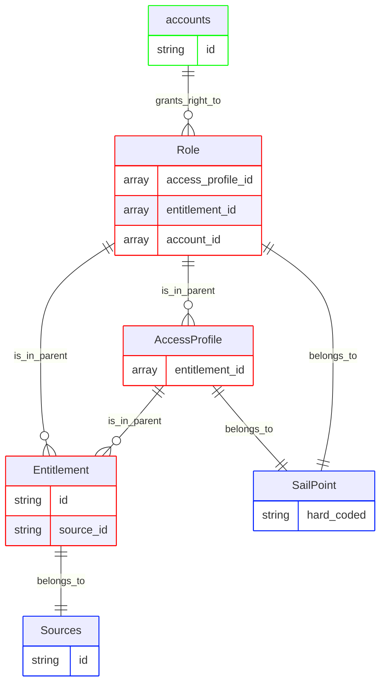
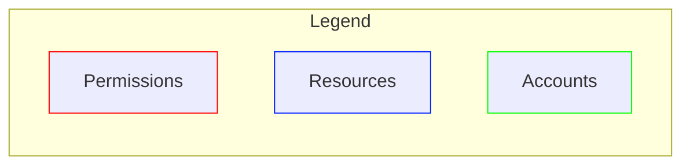

# SailPoint ISC V3 pipeline configuration

This document describes the pipeline that ingests SailPoint Identity Security Cloud data into RadiantOne Identity Data Platform. It covers the access chain model, configuration, vertices and edges, and release history. The pipeline reads SailPoint's Accounts, Roles, Access Profiles, Entitlements, and Sources. It models the full SailPoint access chain as a pure permission hierarchy in the Identity Data Platform graph. The model has no group vertices.

This pipeline ships as a reusable mapping profile ([sailpoint-identity-security-cloud-mapping-profile-v1](resources/sailpoint-identity-security-cloud-mapping-profile-v1.yaml)). Deploy it and reference it from a mapping overload (see the [Configuration walkthrough](#configuration-walkthrough) section of this document). For the connector's identity, supported versions, and data source properties, see the [readme](readme.md).

## Pipeline identity

This section describes how the pipeline fits into RadiantOne: its identity, what it depends on, and the platform versions it's been verified against. Refer to the following tables for more details. A mapping profile isn't a connector, so it doesn't carry the connector identity tables that the [readme](readme.md#connector-identity) does. Instead, the following tables cover what's relevant to a pipeline.

<table>
  <tr>
    <th scope="row" align="left">Name</th><td>SailPoint pipeline (<code>sailpoint-identity-security-cloud-mapping-profile-v1</code>)</td>
  </tr>
  <tr>
    <th scope="row" align="left">Source system</th><td>SailPoint ISC (Identity Security Cloud)</td>
  </tr>
  <tr>
    <th scope="row" align="left">Target platform</th><td>RadiantOne Identity Data Platform</td>
  </tr>
  <tr>
    <th scope="row" align="left">Deployment model</th><td>Reusable mapping profile + a short, environment-specific mapping overload example (see <a href="#configuration-walkthrough">Configuration walkthrough</a>)</td>
  </tr>
</table>

### Platform versions tested against

<table>
  <tr>
    <th scope="row" align="left">Identity Data Platform</th><td>2.4.0</td>
  </tr>
</table>

### Deployment scope

<table>
  <tr>
    <th scope="row" align="left">Current deployment</th><td>One SailPoint tenant per graph. <code>repositoryName</code>, <code>repositoryDisplayname</code>, and <code>repositoryDescription</code> on <code>sailpoint-roles</code> and <code>sailpoint-accessprofile</code> can be overridden through <code>template-overload</code> (see <a href="#pipeline-configuration">Pipeline configuration</a>) to name the shared <code>SailPoint</code> placeholder <code>rt_resource</code> node. The per-source <code>rt_repository</code> and <code>rt_resource</code> nodes created from <code>sailpoint-source</code> are keyed on the source's own <code>id</code>, so this override doesn't affect them.</td>
  </tr>
</table>

## Terms

### The two systems involved

| Term | Plain-language meaning |
| --- | --- |
| **SailPoint Identity Security Cloud (ISC)** | A third-party identity governance product. It's the *source of truth* that this pipeline reads from. It tracks who has which accounts, which roles they've been assigned, and which specific permissions those roles grant. |
| **RadiantOne Identity Data Platform** | The platform this pipeline runs on. Data Sync Config is the service that defines and runs pipelines (connectors, YAML configuration, ingestion). The identity observability graph and UI are where the resulting data lives and can be browsed. |

### SailPoint's own vocabulary

| Term | Plain-language meaning |
| --- | --- |
| **Identity** | A person, at the SailPoint level, one identity per human, independent of how many systems they have logins on. SailPoint's own `publicidentity` object represents identities at this level. |
| **Account** | A specific login/record that represents one identity on one target system. For example, an Active Directory login, a database login. One identity can have several accounts, one per system they have access to. SailPoint's `vdAccount` object represents accounts at this level. |
| **Role** | A named bundle of access that gets assigned to people (for example, "Sales Manager"). Assigning someone a Role is a shortcut for giving them everything the Role contains. |
| **Access Profile** | A smaller, reusable bundle of access, usually scoped to one system, that Roles are built from. A Role is often just "a collection of Access Profiles." |
| **Entitlement** | The most granular, real permission that actually exists on a target system; for example, a specific Active Directory group membership, or a specific database privilege. Everything above (Access Profile, Role) ultimately exists to grant Entitlements. |
| **Source** | A target system SailPoint manages access for; for example, Active Directory, a PRISM database, etc. Every Entitlement and Access Profile belongs to exactly one Source. |

> **A note on Identity vs. Account, since it's easy to conflate them:** Role assignment (`roleAssignedIdentities`) happens at the **identity** level: one grant per person, regardless of how many accounts they have. But knowing *which system* an account lives on (needed to place it in the right repository - see the `is_in_repository` row in [Edges](#edges)) is **account**-level information; an identity alone doesn't carry it, since one identity's several accounts can span several different systems. This pipeline's `rt_account` vertex is fed by `sailpoint-account` (account-level, `vdAccount`) rather than `publicidentity` (identity-level) specifically because it needs both: the identity-level id for role matching, and the account-level `sourceId` for repository placement. `rt_account` is keyed on `identityId` so it still collapses each identity's several accounts into one vertex (identities with a Role assignment but no accounts yet don't currently materialize in the graph at all).

The real-world chain this pipeline currently represents is as follows: **a person's Account → the Roles they're assigned → the Access Profiles those Roles contain → the Entitlements those Access Profiles (or Roles) grant → the Source system each Entitlement actually lives on.**

## Configuration walkthrough

To configure RadiantOne, complete the steps in the following sections.

### Configure RadiantOne for identity observability

1. [Use the connector to create a naming context](readme.md#configure-radiantone) for connecting to SailPoint ISC, mount the data source under it, and publish every attribute. RadiantOne automatically configures the naming attribute, but you must explicitly publish the remaining attributes. Unpublished attributes are unavailable under the naming context, and graph mappings that reference them resolve to no value without reporting an error.
2. Create a second proxy data source in your RadiantOne Identity Data Platform's Data Sync Config URL, of type **RadiantOne**, over the SailPoint ISC data source's naming context. Identity observability reads change events through the proxy, never through the connector data source directly. To configure the proxy data source, follow these steps:
      1. From the Data Sources page, click **+ New source** and select the **RadiantOne** Data Source Type. Give it a descriptive name, since this is the name you'll supply through `template-overload` when creating the mapping overload, for example, `sailpoint-proxy` (see the [Pipeline configuration](#pipeline-configuration) section of this document).
      2. Enter the connection details and credentials for your RadiantOne instance in **Host**, **Port**, **Bind DN**, and **Bind Password**.
      3. Set **Base DN** to the naming context where the SailPoint ISC connector's data is exposed in the Directory Namespace (for example, `o=sailpoint`).
      4. Click **Test Connection**, then **Save** to create the data source.
3. Load the mapping profile (<a href="resources/sailpoint-identity-security-cloud-mapping-profile-v1.yaml"><code>sailpoint-identity-security-cloud-mapping-profile-v1.yaml</code></a>) in **Identity Observability** > **Mapping Profiles** as `sailpoint-identity-security-cloud-mapping-profile-v1`. The mapping profile contains the full model described in this document: all `source-objects`, `derived-source-objects`, `vertices`, and `edges`. **The mapping profile file must never contain a `templates:` block**. Its content *is* what gets referenced by a mapping overload's `ref:`; a mapping profile can't reference itself.
4. Create a mapping overload that references the mapping profile through `ref: sailpoint-identity-security-cloud-mapping-profile-v1` and supplies the real data source name through `template-overload`. For an example, see the <a href="resources/sailpoint-identity-security-cloud-mapping-overload-example-v1.yaml"><code>sailpoint-identity-security-cloud-mapping-overload-example-v1.yaml</code></a> file. For the full list of overridable properties, see the [Pipeline configuration](#pipeline-configuration) section of this document.

    The following example shows a mapping overload for a data source named `sailpoint-proxy`:

    ```yaml
    version: v1
    templates:
      - ref: functions_v1

      - ref: sailpoint-identity-security-cloud-mapping-profile-v1
        template-overload:
          source-objects:
            - name: sailpoint-source
              datasource: sailpoint-proxy  # your-real-datasource name
            - name: sailpoint-account
              datasource: sailpoint-proxy  # your-real-datasource name
            - name: sailpoint-roles
              datasource: sailpoint-proxy  # your-real-datasource name
              meta-attributes:
                - name: repositoryName
                  literal: SailPoint  # unique per SailPoint tenant
                - name: repositoryDisplayname
                  literal: SailPoint
                - name: repositoryDescription
                  literal: This is the repository for SailPoint
            - name: sailpoint-accessprofile
              datasource: sailpoint-proxy  # your-real-datasource name
              meta-attributes:
                - name: repositoryName
                  literal: SailPoint  # identical to the sailpoint-roles value
                - name: repositoryDisplayname
                  literal: SailPoint
                - name: repositoryDescription
                  literal: This is the repository for SailPoint
            - name: sailpoint-entitlement
              datasource: sailpoint-proxy  # your-real-datasource name
    ```

    `template-overload` parameterizes `datasource` on all five source objects. On `sailpoint-roles` and `sailpoint-accessprofile`, it also parameterizes `repositoryName`, `repositoryDisplayname`, and `repositoryDescription`, which feed the shared "SailPoint" placeholder `rt_resource` (see [Vertices](#vertices)). `repositoryName` is the vertex-uid of that placeholder, so it must be identical in both source objects; otherwise, they create two placeholder vertices instead of one. Keep the other two values identical as well, because both source objects write them to the same vertex. `sailpoint-source` has no `repositoryName` field, because its `rt_repository` and `rt_resource` linkage uses its own `id`. On `sailpoint-account`, the `repositoryName` literal doesn't feed any vertex property, so overriding it has no effect.

5. Apply the mapping overload. No data reaches the graph until you apply it. To apply the mapping overload, follow these steps:
    1. Go to **Identity Observability** > **Pipeline Configuration**.
    2. Load the mapping overload that you created in step 4.
    3. Apply the mapping overload.
    4. Confirm that the pipeline reaches the running state, the processed-event count matches the entry count, and the rejected-event count doesn't increase.

## Entitlement model

The chain described in the [Terms](#terms) section, Account → Role → AccessProfile → Entitlement → Resource, is modeled in the graph as follows:

```text
Account -grants_right_to-> Role -is_in_parent-> AccessProfile -is_in_parent-> Entitlement -belongs_to-> Resource
```





## Pipeline configuration

A mapping overload is intended to override the following properties on the mapping profile through `template-overload` (see the example in step 4 of the [Configure RadiantOne for identity observability](#configure-radiantone-for-identity-observability) section of this document):

| Property | Required | Type | Allowed values | Description |
| --- | :---: | --- | --- | --- |
| `datasource` (on `sailpoint-source`) | Yes | `string` | Any RadiantOne data source name | Real (RadiantOne proxy) data source backing the `vdSource` feed (used by both `rt_repository` and `rt_resource`). |
| `datasource` (on `sailpoint-account`) | Yes | `string` | Any RadiantOne data source name | Real (RadiantOne proxy) data source backing the `vdAccount` feed. |
| `datasource` (on `sailpoint-roles`) | Yes | `string` | Any RadiantOne data source name | Real (RadiantOne proxy) data source backing the `vdRole` feed. |
| `datasource` (on `sailpoint-accessprofile`) | Yes | `string` | Any RadiantOne data source name | Real (RadiantOne proxy) data source backing the `vdAccessProfile` feed. |
| `datasource` (on `sailpoint-entitlement`) | Yes | `string` | Any RadiantOne data source name | Real (RadiantOne proxy) data source backing the `vdEntitlement` feed. |
| `repositoryName` (on `sailpoint-roles`) | Yes | `string` | Any string | Identifies the shared "SailPoint" placeholder `rt_resource` node (used by Role and AccessProfile). It's the vertex-uid of that node, so it must be identical to the `repositoryName` override on `sailpoint-accessprofile`. |
| `repositoryName` (on `sailpoint-accessprofile`) | Yes | `string` | Any string | Must be identical to the value used for `sailpoint-roles` above. |
| `repositoryDisplayname` (on `sailpoint-roles`) | No | `string` | Any string | Friendly label for the shared placeholder resource. |
| `repositoryDisplayname` (on `sailpoint-accessprofile`) | No | `string` | Any string | Friendly label for the shared placeholder resource. |
| `repositoryDescription` (on `sailpoint-roles`) | No | `string` | Any string | Description for the shared placeholder resource. |
| `repositoryDescription` (on `sailpoint-accessprofile`) | No | `string` | Any string | Description for the shared placeholder resource. |

### Vertices

| Vertex | Meaning in this model |
| --- | --- |
| `rt_account` | A SailPoint account (`vdAccount`), keyed on `identityId` |
| `rt_permission` | Role, AccessProfile, **and** Entitlement. All three, distinguished by a `type` property fed from `permissionType` |
| `rt_resource` | Either the generic "SailPoint" placeholder (for Role/AccessProfile) or a real per-source resource like AD/PRISM (for Entitlement) |
| `rt_repository` | One real repository per SailPoint source (AD, PRISM, etc.); no shared placeholder here, unlike `rt_resource` |

### Edges

The following table summarizes the mechanism used to create each edge in this pipeline. Each edge uses one of three mechanisms:

- **Normalization**: the edge is created automatically because both vertices it connects are fed by the same source-object. No rules needed.
- **Direct-link**: a rule resolves the target vertex-uid directly from event data, typically a fanned-out JSON field.
- **Key-based**: a rule matches the target using an actual foreign/reference key (`link-condition`), rather than resolving straight to a vertex-uid.

| Edge | Source → Target | Mechanism | Purpose | Notes |
| --- | --- | --- | --- | --- |
| `grants_right_to` | `rt_account` → `rt_permission` (Role) | Direct-link | Connects an account to the Roles it's assigned, via the fanned-out `roleAssignedIdentities[]` array | |
| `is_in_parent` | `rt_permission` → `rt_permission` | Direct-link (`event-vertex-role: TARGET`) | Builds the Role → AccessProfile → Entitlement hierarchy | Modeled as a permission hierarchy (grandchild → parent → account), the opposite direction from a group hierarchy - this is why Role, AccessProfile, and Entitlement are all `rt_permission` rather than `rt_group`. |
| `belongs_to` | `rt_permission` → `rt_resource` | Normalization | Links Role and AccessProfile to the shared "SailPoint" placeholder resource | Role/AccessProfile carry no real per-source data, so both key on the same repositoryName value (`SailPoint` by default) and collapse into one shared placeholder vertex instead of one per role/profile. |
| `belongs_to` (second instance, same name) | `rt_permission` → `rt_resource` | Direct-link (on `source_id`) | Links Entitlement to its real, per-source resource (AD, PRISM, etc.) | Points at the real resource vertex already created by `sailpoint-source`; Entitlement needs only this edge, not its own vertex-creation linkage. |
| `is_in_repository` | `rt_resource` → `rt_repository` | Normalization | Places each resource in its matching per-source repository | Only `sailpoint-source` feeds `rt_repository`, so the shared "SailPoint" placeholder resource has no repository counterpart to link to. |
| `is_in_repository` | `rt_account` → `rt_repository` | Key-based (`link-condition`) | Places each account in the repository matching its own source | Different source-objects feed `rt_account` and `rt_repository`, with no shared linkage, so this uses a `link-condition` (account's `sourceId` = repository's `id`) instead of normalization. |

## Change log

| Version | Date | Description |
| --- | --- | --- |
| 1.0 | 2026-08-05 | Initial version of this document. |

## Appendix A: Attribute reference

This is a complete inventory of every field this pipeline reads from SailPoint, every literal and computed value it injects, and every property it writes onto the graph - gathered directly from the current mapping profile file.

### Source-objects

Fields read from SailPoint, and values injected. The **Kind** column uses the following values:

- **backend attribute (real data)**: read from the connector's entry for that source object.
- **meta-attribute (literal)**: a fixed value that the mapping profile injects, unless the mapping overload overrides it.
- **computed attribute**: a value that the pipeline derives at ingestion time, rather than reading it from the connector, by applying a function to other fields.

#### `sailpoint-source` (reads SailPoint's `vdSource`)

Creates one record per SailPoint-managed system (AD, PRISM, IdentityNow, etc.). Feeds both `rt_repository` and `rt_resource`.

| Field | Kind | Notes |
| --- | --- | --- |
| `description` | backend attribute (real data) | |
| `id` | backend attribute (real data) | Used as `rt_resource` and `rt_repository` vertex-uid. |
| `name` | backend attribute (real data) | |
| `owner` | backend attribute (real data) | |
| `status` | backend attribute (real data) | |
| `type` | backend attribute (real data) | |
| `repositoryType` | meta-attribute (literal) | `Accounts` |
| `repositoryFamily` | meta-attribute (literal) | `SailPoint` |
| `resourceType` | meta-attribute (literal) | `IAM` |

#### `sailpoint-account` (reads SailPoint's `vdAccount`)

One record per account (a person's login on a given system).

| Field | Kind | Notes |
| --- | --- | --- |
| `id` | backend attribute (real data) | |
| `identityId` | backend attribute (real data) | Used as `rt_account` vertex-uid, deliberately instead of `id`. |
| `sourceId` | backend attribute (real data) | Used by the `is_in_repository` key-based rule to match this account to its repository. |
| `sourceName` | backend attribute (real data) | |
| `name` | backend attribute (real data) | |
| `disabled` | backend attribute (real data) | |
| `repositoryFamily` | meta-attribute (literal) | `SailPoint` |
| `repositoryType` | meta-attribute (literal) | `Accounts` |
| `repositoryName` | meta-attribute (literal) | `SailPoint` |

#### `sailpoint-roles` (reads SailPoint's `vdRole`)

One record per Role.

| Field | Kind | Notes |
| --- | --- | --- |
| `accessProfiles` | backend attribute (real data, array) | Fanned out by `sailpoint-roles-access-profile`. |
| `description` | backend attribute (real data) | |
| `enabled` | backend attribute (real data) | |
| `entitlements` | backend attribute (real data, array) | Fanned out by `sailpoint-roles-entitlement` (direct role→entitlement grants). |
| `id` | backend attribute (real data) | Used as `rt_permission` vertex-uid. |
| `name` | backend attribute (real data) | |
| `owner` | backend attribute (real data) | |
| `roleAssignedIdentities` | backend attribute (real data, array) | Fanned out by `sailpoint-roles-identities`. |
| `repositoryName` | meta-attribute (literal) | `SailPoint`. Also doubles as the `rt_resource` placeholder key. |
| `repositoryDisplayname` | meta-attribute (literal) | `SailPoint` |
| `repositoryDescription` | meta-attribute (literal) | `This is the repository for SailPoint` |
| `repositoryType` | meta-attribute (literal) | `Accounts` |
| `repositoryFamily` | meta-attribute (literal) | `SailPoint` |
| `permissionType` | meta-attribute (literal) | `Role` |
| `resourceType` | meta-attribute (literal) | `IAM` |
| `displayname` | computed attribute | `"Role " + name` |

#### `sailpoint-accessprofile` (reads SailPoint's `vdAccessProfile`)

One record per Access Profile.

| Field | Kind | Notes |
| --- | --- | --- |
| `description` | backend attribute (real data) | |
| `enabled` | backend attribute (real data) | |
| `entitlements` | backend attribute (real data, array) | Fanned out by `sailpoint-access-profile-entitlements`. |
| `id` | backend attribute (real data) | Used as `rt_permission` vertex-uid. |
| `name` | backend attribute (real data) | |
| `owner` | backend attribute (real data) | |
| `source` | backend attribute (real data, object) | |
| `repositoryName` | meta-attribute (literal) | `SailPoint`. Also doubles as the `rt_resource` placeholder key. |
| `repositoryDisplayname` | meta-attribute (literal) | `SailPoint` |
| `repositoryDescription` | meta-attribute (literal) | `This is the repository for SailPoint` |
| `repositoryType` | meta-attribute (literal) | `Accounts` |
| `repositoryFamily` | meta-attribute (literal) | `SailPoint` |
| `permissionType` | meta-attribute (literal) | `AccessProfile` |
| `resourceType` | meta-attribute (literal) | `IAM` |
| `displayname` | computed attribute | `"Access Profile " + name` |

#### `sailpoint-entitlement` (reads SailPoint's `vdEntitlement`)

One record per Entitlement - the most granular real permission.

| Field | Kind | Notes |
| --- | --- | --- |
| `attribute` | backend attribute (real data) | |
| `attributes` | backend attribute (real data) | |
| `description` | backend attribute (real data) | |
| `directPermissions` | backend attribute (real data) | |
| `id` | backend attribute (real data) | Used as `rt_permission` vertex-uid. |
| `name` | backend attribute (real data) | |
| `owner` | backend attribute (real data) | |
| `privileged` | backend attribute (real data) | |
| `source` | backend attribute (real data, object) | Fanned out by `sailpoint-entitlements-source`; this is what points each entitlement at its real resource. |
| `repositoryName` | meta-attribute (literal) | `SailPoint` |
| `repositoryDisplayname` | meta-attribute (literal) | `SailPoint` |
| `repositoryDescription` | meta-attribute (literal) | `This is the repository for SailPoint` |
| `repositoryType` | meta-attribute (literal) | `Accounts` |
| `repositoryFamily` | meta-attribute (literal) | `SailPoint` |
| `permissionType` | meta-attribute (literal) | `Entitlement` |
| `resourceType` | meta-attribute (literal) | `IAM` |
| `displayname` | computed attribute | `"Entitlement " + name` |

### Derived source-objects

Fan-out fields:

| Derived object | Unpacks array | Extracted fields → alias | Carried over from parent | Notes |
| --- | --- | --- | --- | --- |
| `sailpoint-roles-identities` | `roleAssignedIdentities` (on Role) | `id` → `role_assigned_identities` | `id` (Role's own id) | Used to connect accounts to roles; `roleAssignedIdentities[].id` = the identity's id = `account.identityId` = the `rt_account` vertex-uid. |
| `sailpoint-roles-access-profile` | `accessProfiles` (on Role) | `id` → `access_profile_id` | `id` | Unpacks each Role's `accessProfiles[]` array, one row per access profile the role grants. |
| `sailpoint-roles-entitlement` | `entitlements` (on Role) | `id` → `entitlement_id` | `id` | Unpacks each Role's `entitlements[]` array, one row per entitlement the role grants directly. |
| `sailpoint-access-profile-entitlements` | `entitlements` (on AccessProfile) | `id` → `entitlement_id` | `id` | One row per entitlement the access profile grants. |
| `sailpoint-entitlements-source` | `source` (on Entitlement) | `id` → `source_id`; `name` → `source_name` | `id`, `description`, `name`, `source`, `permissionType`, `resourceType` | Extracts the real source id/name for each entitlement; also recomputes `displayname` as `"Entitlement " + name`. |

Each of the above follows the standard fan-out pattern used across this platform: `derived-from` the parent stream, `iterate-json-attribute` on the array to explode, `inherit-attributes` to carry the parent's `id` along, and `json-fields` with an `alias` to avoid clashing with the inherited `id`.

### Vertex properties

Properties written to the graph:

#### `rt_account`

| Property (graph) | Sourced from | Notes |
| --- | --- | --- |
| vertex-uid | `identityId` | Chosen instead of `id` specifically so `direct-link` on `roleAssignedIdentities[].id` resolves correctly without an extra lookup object. |
| `name` | `name` | |
| `displayname` | `name` | |
| `disabled` | `disabled` | |
| `identifier` | `identityId` | |
| `internal` | `id` | The account's own raw SailPoint id, kept as a secondary property. |

#### `rt_permission`

Fed by three separate linkages (Role, AccessProfile, Entitlement), each producing this same set of properties:

| Property (graph) | Sourced from | Notes |
| --- | --- | --- |
| vertex-uid | `id` (of whichever of the three feeds it) | |
| `name` | `name` | |
| `displayname` | `displayname` | The computed "Role X" / "Access Profile X" / "Entitlement X" value. |
| `type` | `permissionType` | `Role`, `AccessProfile`, or `Entitlement` |
| `family` | `repositoryFamily` | Always `SailPoint`. |

#### `rt_repository`

| Property (graph) | Sourced from | Notes |
| --- | --- | --- |
| vertex-uid | `id` (from `sailpoint-source`) | |
| `name` | `name` | |
| `displayname` | `name` | |
| `description` | `description` | |
| `type` | `repositoryType` | |
| `family` | `repositoryFamily` | |
| `id` | `id` | Marked `transient: true`; exists only to support the `is_in_repository` key-based rule, not stored as a visible graph property. |

#### `rt_resource`

Fed by three linkages: `sailpoint-source` (creates the real per-source resource) and `sailpoint-roles`/`sailpoint-accessprofile` (both create the shared placeholder). Each linkage sources these properties from different fields:

| Property (graph) | Sourced from | Notes |
| --- | --- | --- |
| vertex-uid | `id` (from `sailpoint-source`); `repositoryName` (from `sailpoint-roles`/`sailpoint-accessprofile`, `SailPoint` by default) | `sailpoint-roles` and `sailpoint-accessprofile` both resolve to the same vertex-uid, so they merge into one shared vertex regardless of how many roles/access profiles exist - the "generic SailPoint placeholder resource" discussed in the `belongs_to` row notes in [Edges](#edges). |
| `name` | `name` (from `sailpoint-source`); `repositoryName` (from `sailpoint-roles`/`sailpoint-accessprofile`) | |
| `displayname` | `name` (from `sailpoint-source`); `repositoryDisplayname` (from `sailpoint-roles`/`sailpoint-accessprofile`) | |
| `description` | `description` (from `sailpoint-source`); `repositoryDescription` (from `sailpoint-roles`/`sailpoint-accessprofile`) | |
| `type` | `type` (from `sailpoint-source`); `resourceType` (from `sailpoint-roles`/`sailpoint-accessprofile`) | |
| `family` | `repositoryFamily` (all three linkages) | |

### Edge rules

Rule fields used:

| Edge | Rule | Mechanism | Fields used |
| --- | --- | --- | --- |
| `is_in_repository` | `account_in_source_repository` | Key-based (`link-condition`) | Account's sourceId EQUALS repository's id |
| `grants_right_to` | `identity_grants_role` | Direct-link | `vertex-uid: role_assigned_identities` |
| `belongs_to` (2nd instance) | `entitlement_in_source` | Direct-link | `vertex-uid: source_id` |
| `is_in_parent` | `roles-access-profile` | Direct-link (`event-vertex-role: TARGET`) | `vertex-uid: access_profile_id` |
| `is_in_parent` | `roles-entitlement` | Direct-link (`event-vertex-role: TARGET`) | `vertex-uid: entitlement_id` |
| `is_in_parent` | `access-profile-entitlement` | Direct-link (`event-vertex-role: TARGET`) | `vertex-uid: entitlement_id` |
